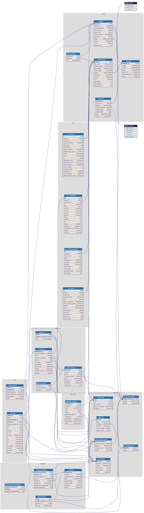

# Modelo de datos

`modelo.dbml` es la fuente de verdad del diagrama ER (formato [DBML](https://dbml.dbdiagram.io/docs/)).

- **Ver/editar visualmente:** pegar el contenido en https://dbdiagram.io/d, o usar la extensión de VS Code "DBML Live Preview".
- **Regenerar `modelo.svg`:** `npx -y @softwaretechnik/dbml-renderer -i docs/modelo/modelo.dbml -o docs/modelo/modelo.svg`
- **Generar DDL MySQL de referencia:** `npx -y -p @dbml/cli dbml2sql --mysql docs/modelo/modelo.dbml`

Los scripts de `sql/` siguen siendo los que se ejecutan en la base; si cambia una tabla, actualizar ambos.

